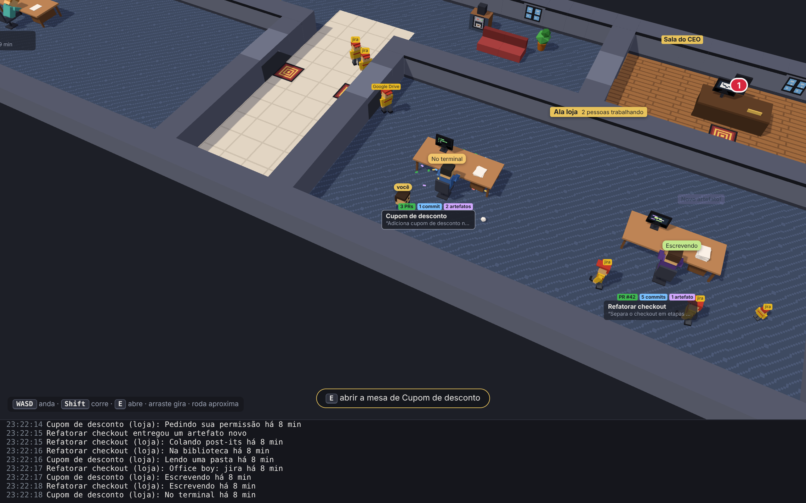
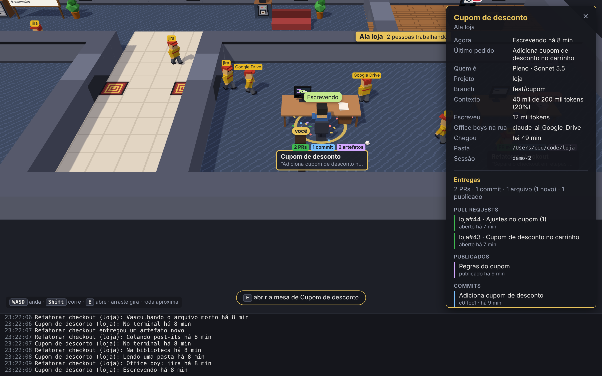

# CEO de Mentirinha

Um escritório 3D em que cada sessão do Claude Code é um funcionário na sua mesa. Você é o
CEO: anda pela casa, passa pelas mesas e entende o que cada agente está fazendo, sem ler log.



## Controles

| Tecla ou mouse | O que faz |
| --- | --- |
| `W` `A` `S` `D` ou setas | anda (para onde a câmera olha) |
| `Shift` | corre |
| `E`, `Enter` ou espaço | abre o que está perto: a mesa, o computador do CEO (caixa de entrada) ou o quadro de entregas |
| clique | abre a mesa, a placa da ala, o computador ou o quadro |
| arrastar | gira a câmera |
| roda do mouse | aproxima e afasta |
| `Esc` | fecha o painel |



A v1 é **somente leitura**: só lê os arquivos que o Claude Code já grava em `~/.claude`,
não envia prompts, não usa chave de API e não manda nada pela rede.

## Como rodar

Requer Node 22 ou mais novo.

```sh
npm install
npm run dev            # abre o app lendo ~/.claude
CEO_DEMO=1 npm run dev # abre com sessões falsas, sem precisar do Claude Code
```

Outros comandos:

| Comando | O que faz |
| --- | --- |
| `npm test` | testes do parser, do leitor incremental e do estado das sessões |
| `npm run typecheck` | checagem de tipos |
| `npm run build` | build de produção em `out/` |
| `npm start` | roda o build de produção |
| `npm run inspect` | Fase 0: mostra a estrutura dos seus transcripts (só nomes de campos, nunca conteúdo) |
| `npm run arte` | Fase 6: gera de novo a pixel art (usada como textura no 3D) e o mapa do hall a partir de `scripts/gerar-arte.mjs` |

Variáveis de ambiente:

| Variável | Padrão | Efeito |
| --- | --- | --- |
| `CEO_IDLE_MINUTES` | `5` | minutos sem escrita até o funcionário cochilar |
| `CEO_RECENT_HOURS` | `6` | na abertura, só lê transcripts alterados neste intervalo |
| `CLAUDE_CONFIG_DIR` | `~/.claude` | pasta de dados do Claude Code |
| `CEO_DEMO` | - | `1` mostra sessões falsas |

## O que aparece no escritório

| No jogo | No Claude Code |
| --- | --- |
| Você | o CEO de terno azul e gravata dourada, com a etiqueta "você"; anda pela casa e não atravessa paredes nem móveis |
| Casa | o escritório é uma casa em 3D (Three.js): o hall de entrada em cima e um corredor central descendo dele, com os cômodos dos dois lados |
| Hall de entrada | mapa do Tiled (`assets/mapa/escritorio.json`): porta da rua, estante de skills, fichário, café e a Sala do CEO (você), ligada ao hall por uma porta |
| Ala (cômodo) | projeto (`cwd`), com uma porta para o corredor; com número ímpar de projetos, o último par ganha uma sala livre |
| Mesa | sessão ativa, ordenada por branch dentro da ala |
| Funcionário | sentado de costas para a câmera, olhando o monitor (você vê a tela por cima do ombro) |
| Cor da roupa | modelo: Opus = diretor (roxo), Sonnet = pleno (azul), Haiku = júnior (verde-água) |
| Pose e monitor | ferramenta em uso: digitando (Edit, Bash), lendo uma pasta (Read, Web), lupa (Grep, Glob), apontando (Agent) |
| Balão acima da cabeça | nome da ferramenta em uso; MCP aparece como "Office boy" |
| Post-its na mesa | lista de TODOs sendo atualizada |
| Pilha de papel | contexto do último turno (uma folha a cada 20 mil tokens); folhas novas caem na pilha |
| Suor, café e papel rosado | contexto acima de 80% do limite |
| Monitor vermelho, papel amassado e fumaça | uma ferramenta voltou com erro |
| Dormindo com Z | sem escrita há `CEO_IDLE_MINUTES` |
| Liderados | subagentes: entram pela porta da rua, atravessam o hall e o corredor, entram pela porta da ala, ficam ao lado do chefe e fazem o caminho de volta ao terminar |
| Office boys na portaria | chamadas a conectores MCP: cada chamada sai da mesa e entra na fila do servidor na portaria. Volta com envelope se deu certo, ou de mãos vazias e perdido se falhou |
| Plaquinhas coloridas acima do nome | entregas da sessão e dos ajudantes: PR (verde), commits (azul) e artefatos (lilás: arquivos criados e páginas publicadas) |
| Confete e "PR #12 aberto!" | a sessão acabou de abrir um PR; commit e artefato novo também sobem um aviso menor |
| Quadro de entregas no hall | totais de PRs, artefatos e commits da casa; clicar lista tudo, com links |
| Log no rodapé | quem chegou, quem saiu, mudanças de ferramenta e PRs abertos |

Role com a roda do mouse ou arraste para andar pelo escritório.

## Arquitetura

Os dados andam em uma direção só, dos arquivos até a tela:

1. `src/main/watcher.ts` observa `~/.claude/projects` e `~/.claude/sessions`.
2. `src/main/incremental-reader.ts` lê só as linhas novas de cada arquivo.
3. `src/main/parser.ts` é o único módulo que conhece o formato dos transcripts.
4. `src/main/office-store.ts` mantém o estado das sessões e emite só o que mudou.
5. `src/preload/index.ts` expõe `window.office` ao renderer por IPC.
6. `src/renderer/` desenha o escritório em 3D com Three.js e nunca lê arquivos.

```
src/
  main/        watcher, leitor incremental, parser, estado das sessões, IPC
  preload/     ponte segura entre main e renderer
  renderer/    Three.js: casa 3D, mesas, CEO andando (src/renderer/src/world)
  shared/      tipos usados pelos dois lados
fixtures/      transcripts sintéticos para os testes
scripts/       inspeção da Fase 0 e gerador da arte
docs/          resultado da Fase 0
assets/        pixel art e mapa do Tiled (gerados por scripts/gerar-arte.mjs)
```

## Andamento do plano

| Fase | Situação |
| --- | --- |
| 0. Inspeção dos dados | Feita no Claude Code 2.1.318 ([resultado](docs/fase-0-formato-dos-transcripts.md)). Falta repetir no Mac e ver subagentes reais. |
| 1. Esqueleto | Feita: Electron + Vite + TypeScript + Phaser, ponte main/preload/renderer, modo demo. |
| 2. Leitura dos dados | Feita, com testes. Testada contra uma sessão real do Claude Code. |
| 3. Uma mesa por sessão | Feita com formas simples. Falta conferir no Mac abrindo e fechando sessões no terminal. |
| 4. Atividade | Feita: pose e monitor por ferramenta, post-its, erro com papel amassado e fumaça, cansaço com contexto cheio, cochilo e pilha de papel animada. |
| 5. Subagentes | Feita: liderados entram e saem pela porta. Falta validar com arquivos reais de subagente no Mac. |
| 6. Arte e polimento | Feita com pixel art original gerada por script (MIT) e hall no formato do Tiled. |
| Depois da v1: office boys de MCP | Feita, lendo só os transcripts ([demo](docs/office-boys-demo.png)). |
| Depois da v1: entregas (PRs e artefatos) | Feita, lendo só os transcripts ([quadro](docs/quadro-de-entregas.png)). Falta ver no Mac um `pr-link` de verdade. |

## Privacidade

Os transcripts têm código e prompts. O app só lê localmente. Nunca versione um transcript
real: os arquivos em `fixtures/` são sintéticos.
