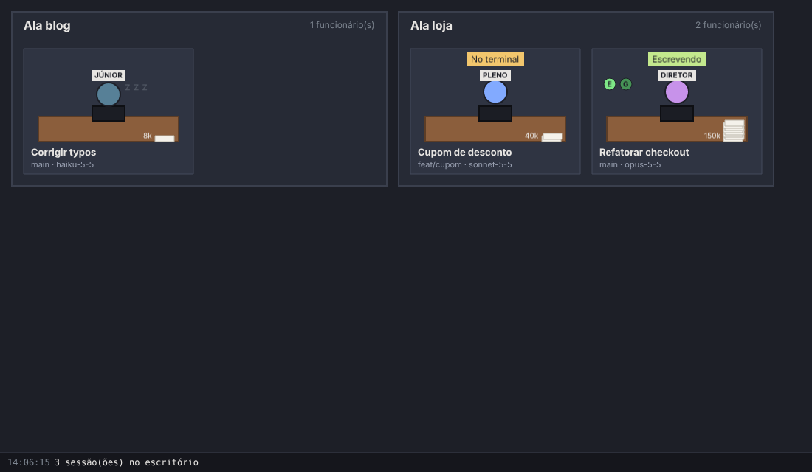

# CEO de Mentirinha

Um escritório 2D em que cada sessão do Claude Code é um funcionário na sua mesa. Você é o
CEO: olha o escritório e entende o que cada agente está fazendo, sem ler log.



A v1 é **somente leitura**: só lê os arquivos que o Claude Code já grava em `~/.claude`,
não envia prompts, não usa chave de API e não manda nada pela rede.

## Como rodar

Requer Node 22 ou mais novo.

```sh
npm install
npm run dev            # abre o app lendo ~/.claude
CEO_DEMO=1 npm run dev # abre com sessões falsas, sem precisar do Claude Code
```

Outros comandos:

| Comando | O que faz |
| --- | --- |
| `npm test` | testes do parser, do leitor incremental e do estado das sessões |
| `npm run typecheck` | checagem de tipos |
| `npm run build` | build de produção em `out/` |
| `npm start` | roda o build de produção |
| `npm run inspect` | Fase 0: mostra a estrutura dos seus transcripts (só nomes de campos, nunca conteúdo) |

Variáveis de ambiente:

| Variável | Padrão | Efeito |
| --- | --- | --- |
| `CEO_IDLE_MINUTES` | `5` | minutos sem escrita até o funcionário cochilar |
| `CEO_RECENT_HOURS` | `6` | na abertura, só lê transcripts alterados neste intervalo |
| `CLAUDE_CONFIG_DIR` | `~/.claude` | pasta de dados do Claude Code |
| `CEO_DEMO` | - | `1` mostra sessões falsas |

## O que aparece no escritório

| No jogo | No Claude Code |
| --- | --- |
| Ala | projeto (`cwd`) |
| Mesa | sessão ativa, ordenada por branch dentro da ala |
| Crachá | modelo: Opus = diretor, Sonnet = pleno, Haiku = júnior |
| Pilha de papel | contexto do último turno (uma folha a cada 20 mil tokens; fica rosa perto de 200 mil) |
| Balão acima da cabeça | ferramenta em uso (Read = "Lendo uma pasta", Bash = "No terminal", MCP = "Office boy") |
| z z z | sem escrita há `CEO_IDLE_MINUTES` |
| Bolinhas verdes ao lado | subagentes (liderados) |
| Log no rodapé | quem chegou, quem saiu e mudanças de ferramenta |

## Arquitetura

Os dados andam em uma direção só, dos arquivos até a tela:

1. `src/main/watcher.ts` observa `~/.claude/projects` e `~/.claude/sessions`.
2. `src/main/incremental-reader.ts` lê só as linhas novas de cada arquivo.
3. `src/main/parser.ts` é o único módulo que conhece o formato dos transcripts.
4. `src/main/office-store.ts` mantém o estado das sessões e emite só o que mudou.
5. `src/preload/index.ts` expõe `window.office` ao renderer por IPC.
6. `src/renderer/` desenha o escritório com Phaser e nunca lê arquivos.

```
src/
  main/        watcher, leitor incremental, parser, estado das sessões, IPC
  preload/     ponte segura entre main e renderer
  renderer/    Phaser: cena do escritório e mesas
  shared/      tipos usados pelos dois lados
fixtures/      transcripts sintéticos para os testes
scripts/       inspeção da Fase 0
docs/          resultado da Fase 0
assets/        arte e mapa (fase 6), com a licença de cada pacote
```

## Andamento do plano

| Fase | Situação |
| --- | --- |
| 0. Inspeção dos dados | Feita no Claude Code 2.1.318 ([resultado](docs/fase-0-formato-dos-transcripts.md)). Falta repetir no Mac e ver subagentes reais. |
| 1. Esqueleto | Feita: Electron + Vite + TypeScript + Phaser, ponte main/preload/renderer, modo demo. |
| 2. Leitura dos dados | Feita, com testes. Testada contra uma sessão real do Claude Code. |
| 3. Uma mesa por sessão | Feita com formas simples. Falta conferir no Mac abrindo e fechando sessões no terminal. |
| 4. Atividade | Parcial: balão da ferramenta, funcionário balançando durante a tool call, cochilo e pilha de papel. |
| 5. Subagentes | Parcial: liderados aparecem ao lado da mesa; falta validar com arquivos reais. |
| 6. Arte e polimento | Não começada. |

## Privacidade

Os transcripts têm código e prompts. O app só lê localmente. Nunca versione um transcript
real: os arquivos em `fixtures/` são sintéticos.
